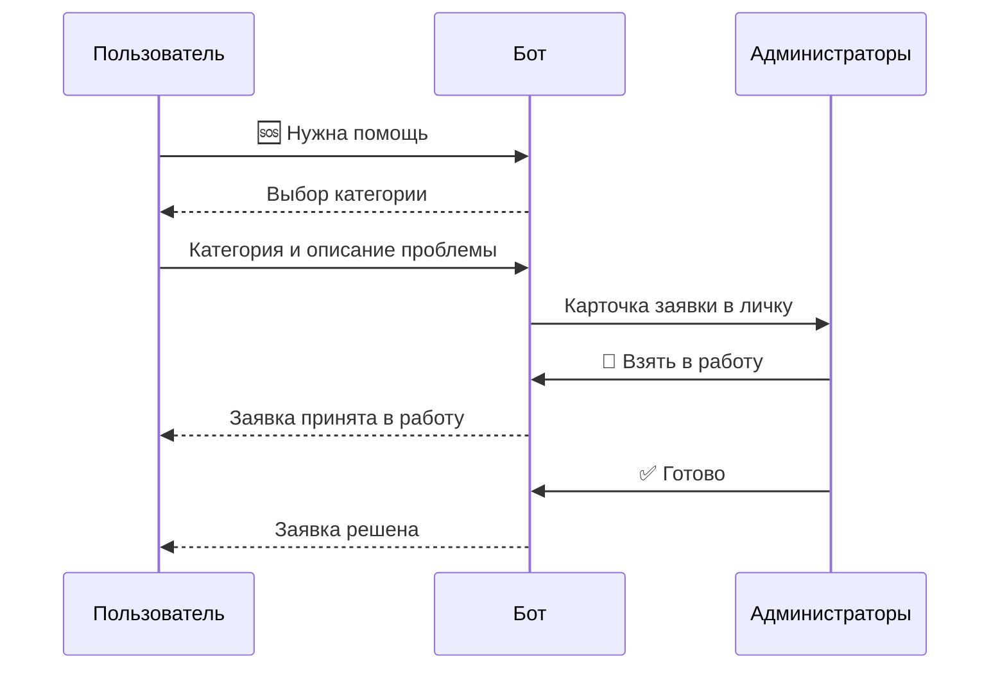
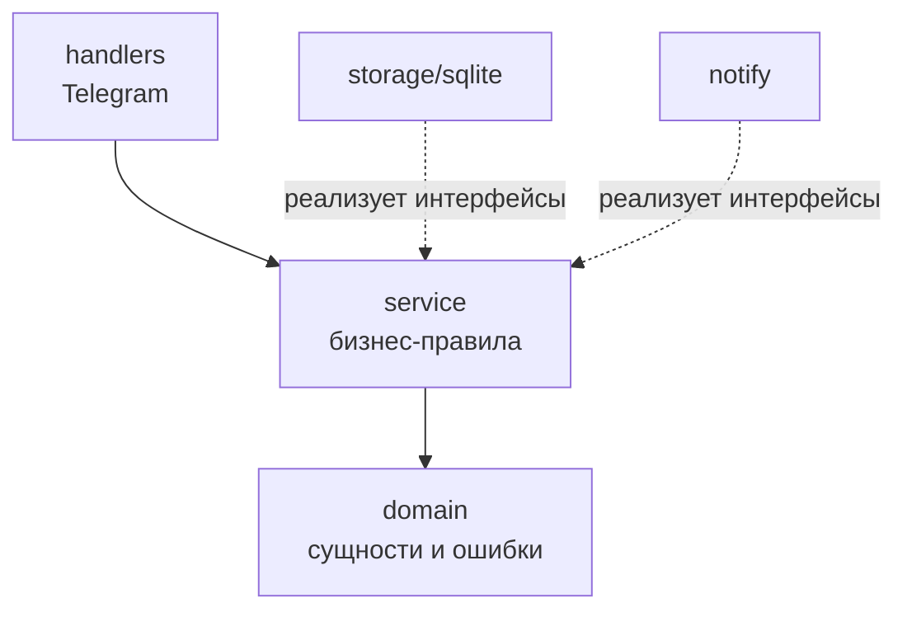

# helpdesk-telegram-bot

Telegram-бот «Техподдержка» для приёма заявок в IT-отдел: пользователь выбирает
категорию и описывает проблему, заявка уходит всем администраторам в личку.
Админ берёт её в работу — это видят остальные, закрывает одной кнопкой.

## Возможности

- Заявка в три шага: категория → описание → подтверждение.
- Главное меню — постоянные кнопки под строкой ввода (reply-клавиатура).
- Карточка заявки приходит каждому админу с кнопками «🔧 Взять в работу» и «✅ Готово».
- Взятие атомарное: двое не возьмут одну заявку, конфликт виден сразу.
- Карточки обновляются у всех админов: видно, кто и когда взял заявку.
- Закрыть может только взявший админ или владелец. Закрытие без комментария.
- Пользователь видит статусы своих заявок и получает уведомления.
- Владелец управляет админами (приглашение по коду на 24 часа) и категориями.
- Снятый админ перестаёт получать заявки, его заявки возвращаются в общий список.
- Данные в локальной SQLite, схема с версионированием миграций.

## Роли

- **Владелец** — задаётся в `OWNER_IDS`. Полные права: управление администраторами
  и категориями, доступ ко всем заявкам.
- **Администратор** — получает заявки в личку, берёт в работу и закрывает.
  Назначается владельцем по коду-приглашению на 24 часа.
- **Пользователь** — создаёт заявки и следит за их статусом в «📋 Мои заявки».

## Как это работает



## Стек

- Go 1.26.11+
- [Telego](https://github.com/mymmrac/telego) v1.13 — Bot API, long polling,
  `telegohandler`
- `modernc.org/sqlite` — SQLite на чистом Go, без CGO
- `joho/godotenv` — чтение `.env`

## Запуск

1. Скопировать `.env.example` в `.env` и заполнить:

```
BOT_TOKEN=...
OWNER_IDS=123456789
TIMEZONE=Europe/Moscow
DB_PATH=data/helpdesk.db
```

2. `run.bat` — соберёт `helpdesk-bot.exe` и запустит бота.
3. Владелец один раз нажимает `/start` — Telegram не даёт ботам писать первыми.

Ручной запуск:

```
go build -o helpdesk-bot.exe ./cmd/bot
helpdesk-bot.exe
```

### Конфигурация

| Переменная | Обязательна | По умолчанию | Назначение |
|---|---|---|---|
| `BOT_TOKEN` | да | — | токен от [@BotFather](https://t.me/BotFather) |
| `OWNER_IDS` | да | — | Telegram ID владельцев через запятую |
| `TIMEZONE` | нет | `Europe/Moscow` | часовой пояс для дат в карточках |
| `DB_PATH` | нет | `data/helpdesk.db` | путь к файлу SQLite |

## Как пользоваться

### Владелец

- «⚙️ Админка» → «👥 Администраторы» → «➕ Добавить администратора»:
  бот выдаёт код и ссылку вида `https://t.me/бот?start=adm_КОД` на 24 часа.
- «🗂 Категории» — добавить, переименовать, скрыть.
- «🛠 Открытые заявки» — список новых и взятых в работу.

### Админ

- «🔧 Взять в работу» закрепляет заявку за админом и обновляет карточки у всех.
- «✅ Готово» закрывает заявку (чужую может закрыть только владелец).
- Потерянную карточку можно найти в «🛠 Открытые заявки».

### Пользователь

- «🆘 Нужна помощь» → категория → описание (можно пропустить) → «✅ Отправить».
- «📋 Мои заявки» — последние 10 заявок со статусами.

## Архитектура

```
cmd/bot/main.go                    сборка приложения и запуск
internal/config                    .env и валидация
internal/domain                    сущности, статусы, ошибки (без Telego и SQL)
internal/storage/sqlite            схема, миграции, репозитории
internal/service                   бизнес-правила: заявки, админы, категории
internal/service/ports.go          интерфейсы хранилищ и уведомлений
internal/telegram                  Telego: маршруты, long polling, lifecycle
internal/telegram/session          состояния диалогов в памяти
internal/telegram/ui               тексты, карточки, клавиатуры
internal/telegram/notify           рассылка карточек и уведомления
internal/telegram/handlers         тонкие хендлеры: update → сервис → отрисовка
```

Зависимости направлены внутрь: `handlers → service → domain`; `storage` и
`notify` — адаптеры, реализующие интерфейсы сервисов. Telego используется
только в `internal/telegram`.



## Тесты

- 29 тестов: правила сервисов, хранилище SQLite, отрисовка интерфейса.
- Запуск: `go test ./...` или панель **Testing** в VS Code.
- Покрытие: сервисы ~83%, SQLite ~78%, UI ~32%.
- Не покрыто автотестами: сетевой слой Telegram и хендлеры — проверены вручную.

## Название в BotFather

- **Name:** `Техподдержка`
- **About:** `Заявки в IT-поддержку: компьютеры, принтеры, интернет, программы, доступы. Нажмите Start → «Нужна помощь».`
- **Description:**

```
Бот технической поддержки организации.

Если не работает компьютер, принтер, интернет, почта, программа или нужен доступ:
1. Нажмите Start.
2. Выберите «🆘 Нужна помощь».
3. Укажите категорию и опишите проблему.
4. Отправьте заявку — администратор получит её и придёт на помощь.

Статус своих обращений смотрите в «📋 Мои заявки».
```

## Данные и ограничения

- База: `data/helpdesk.db` (создаётся автоматически).
- `.env` и `data/` не попадают в git.
- Состояния диалогов хранятся в памяти (15 минут или до перезапуска).
- Пока только текст: фото и файлы к заявке не прикладываются.
